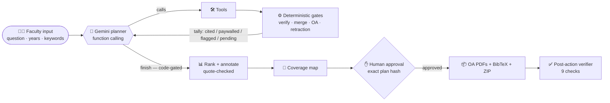

<div align="center">

# 📚 CiteScout AI

### An agentic literature scout that never cites a paper it couldn't verify

[](https://github.com/yashvantatk/citescout/actions/workflows/tests.yml)


**Ziro Agentic AI Hackathon 2026** · Education & Career AI · *Literature Scout & Bibliography Builder*
**Team Three Pointers**

**[▶ Working AI Agent - Live demo](#)** · **[🎬 Demo video](#)** · **[📊 Slides](#)**

</div>

---

## 🎯 The problem

A professor starting a literature review needs **25 relevant papers they can actually open and cite**.
Today that means hours on arXiv and Google Scholar, duplicate preprint/journal versions, paywalls,
and AI tools that **hallucinate citations** — DOIs that point to the wrong paper, or don't exist at all.

## 💡 What CiteScout does

> Type a research question, a year range and keywords. Get back **25 verified, open-access papers**,
> a ranked and annotated reading list, and — **only after you approve** — a ZIP with the legal PDFs
> and a clean BibTeX file.

| You get | How it's guaranteed |
|---|---|
| ✅ **25 cited papers**, every DOI resolved | doi.org lookup + title, author **and** year must match |
| 🔗 **One entry per work** | arXiv preprint and journal version merged, published DOI cited |
| 🔒 **Paywalled papers listed separately** | link only, never downloaded; publisher page checked by a real browser |
| 🚩 **Bad citations flagged** | wrong-title DOIs and **retracted** papers never reach the bibliography |
| 🧭 **A coverage map** | shows which parts of your question the list covers — and the gaps |
| 📦 **PDFs + BibTeX ZIP** | built only after human approval, then re-checked by 9 automated tests |

<p align="center"><b>The LLM decides the strategy. Code decides what counts as a citation.</b></p>

---

## ⭐ Standout features

### 1. 🛡️ Code gates that keep the AI honest
Gemini plans every step, but it **cannot declare victory**. The `finish` tool is rejected by code until
Semantic Scholar has been searched (so published versions and paywalls are found), every pending paper is
verified, and paywalled papers have publisher-page evidence. The agent sees the rejection and fixes its plan
— visible live in the reasoning trace.

### 2. 🔍 Verbatim-quote check on every AI score
Each relevance score must quote the paper's abstract **word for word**. Code checks the quote; if it isn't
in the abstract, the AI's scores are thrown out and the paper falls back to a lexical score with a
*"quote rejected"* badge. **Nothing the model invents reaches the bibliography.**

### 3. 🧭 Gap-aware coverage map
Gemini lists the subtopics a thorough review of *your* question should cover (e.g. *U-Net architectures,
attention mechanisms, MRI/CT modalities*). **Code** counts how many cited papers really address each one,
clusters the list into themes, and spots missing recent years. The agent then searches the gaps before it
finishes. You see 🟩 covered / 🟥 gap for every subtopic.

### 4. 🌐 Real-browser publisher evidence (Browserbase)
APIs say a paper is closed; CiteScout **goes to the publisher and shows you**. A two-tier
[Browserbase](https://www.browserbase.com) inspector tries the Fetch API first, and when a site's JavaScript
check blocks it (Nature's redirect loop returns 502), opens a real cloud browser session that waits for the
check — **without solving CAPTCHAs** — reads the page and records `paywall_confirmed` plus a session
**replay recording**. Evidence only: it never bypasses a paywall or changes a decision.

### 5. 🕸️ Citation snowballing with provenance
If keyword searches fall short of 25, the agent follows the **references and citations** of its top 1–3
cited papers (Semantic Scholar → OpenAlex) and records which seed each new paper came from.

### 6. 🚫 Retraction check
Every citable paper is checked against Crossref update notices (incl. Retraction Watch data).
Retracted papers are flagged, not cited (TC5: Wakefield 1998).

### 7. 📊 Relevance breakdown, not a black box
| Score (0–10) | Who decides | Weight |
|---|---|---|
| Topic match | Gemini (quote-checked) | 40% |
| Method match | Gemini (quote-checked) | 25% |
| Citation impact | Code: citations per year, log-scaled | 20% |
| Recency | Code: position in your year range | 15% |

…plus a 2-sentence **"Why cite this?"** written for your question.

---

## 🧠 How the agent works



### Agent tools

| Tool | What it does |
|---|---|
| `search_arxiv` | keyword search on arXiv (every hit is a green-OA preprint) |
| `search_s2` | Semantic Scholar search with OpenAlex fallback; finds published versions and paywalls |
| `verify_pool` | runs the gates: OA check → DOI verification → retraction check |
| `snowball` | follows references/citations of a top cited paper, with provenance |
| `coverage_gaps` | measures coverage of planner-proposed subtopics, keywords and recent years |
| `inspect_publisher` | Browserbase reads the publisher landing page; records paywall evidence + replay |
| `finish` | stop — **rejected by code** until the gates are satisfied |

Every tool call carries a required one-line `why`, so the UI shows the agent's reasoning step by step.

### A real run (medical image segmentation, 2018–2024)

```
1  search_arxiv    Initial search on arXiv for deep learning medical image segmentation papers.
2  search_s2       Initial search on Semantic Scholar for published papers on medical image segmentation.
3  verify_pool     Verify OA and DOI for the top pending papers.            → cited 18, paywalled 7
4  verify_pool     Verify more pending papers to reach the target of 25.     → cited 32, paywalled 8
5  coverage_gaps   Check subtopic coverage across our cited papers.          → gap: U-Net architectures
6  search_arxiv    Search to cover U-Net architectures subtopic.
7  verify_pool     Verify papers addressing U-Net architectures.             → cited 37
8  finish          Target reached and verified with diverse coverage.
```

Every step above was planned by Gemini. Since this run, `finish` is also **rejected until paywalled papers
have publisher evidence**, so the agent now adds an `inspect_publisher` (Browserbase) step before stopping.

### Deterministic gates (code, not the LLM)

| Gate | Rule |
|---|---|
| **DOI verification** | resolve at doi.org (CSL-JSON, works for Crossref **and** DataCite/arXiv DOIs); title fuzzy ≥ 90 + author overlap ≥ 50% + year ±1 |
| **Version merging** | shared DOI / arXiv / S2 IDs first, then fuzzy title with a *Part I / Part II* guard |
| **Open access** | Unpaywall → OpenAlex → **fail closed** (unknown = never downloaded) |
| **Green-OA rescue** | a paywalled journal paper is still citable when a legal arXiv/repository copy exists |
| **Integrity** | Crossref update notices → retracted papers flagged |
| **Approval** | download refuses unless approval matches the exact plan hash; paywalled items can never enter the plan |
| **Post-action verifier** | re-opens the ZIP: files present, BibTeX re-parses, unique keys, every entry has a DOI, every PDF starts with `%PDF`, PDFs ↔ keys, plan hash, no paywalled download, SHA-256 |
| **Idempotency** | the same approved plan is never downloaded twice |

### Smart BibTeX keys
Google-Scholar style keys — `vaswani2017attention`, `he2016deep` — with `a`/`b` suffixes on collisions.

---

## 🧪 Test cases & proof

| TC | Scenario | Expected | Result |
|---|---|---|---|
| **TC1** | topic query | 25 papers, all DOIs resolved | ✅ |
| **TC2** | ResNet arXiv `1512.03385` + CVPR `10.1109/CVPR.2016.90` | merged into one entry | ✅ |
| **TC3** | paywalled Nature paper `10.1038/nature14236` | link only, no download; Browserbase confirms paywall | ✅ |
| **TC4** | DOI resolves to a different title | flagged, not cited | ✅ |
| **TC5** *(extra)* | retracted paper (Wakefield 1998) | flagged, not cited | ✅ |
| **TC6** *(extra)* | download without approval | blocked; paywalled never planned | ✅ |

- **Live:** the *Test cases* tab re-runs TC1–TC6 against the real APIs and stores results in `citescout.db`.
- **Offline (CI):** 9 tests — mocked Gemini agent loop and finish gates, approval/export/verifier,
  mocked Browserbase, coverage map — run on **every push** via GitHub Actions.

```bash
python test_scenarios.py                                                       # TC1–TC6 live
pytest -q tests_agent_mock.py tests_export.py tests_publisher.py tests_coverage.py   # offline
```

### Metrics from a real live run
| Total time | Gemini planner steps | Sources consulted | Verification pass rate |
|---|---|---|---|
| 207 s | 8 / 8 by Gemini | 121 API requests | 76% |

The *Metrics* tab shows API calls, latency, retries and cache hits per source for every run, and the
*Source evidence log* lists every URL the agent touched.

---

## 🧱 Reliability

- **Model fallback:** Gemini 3.8 Flash → 3.6 Flash → 3.5 Flash-Lite → scripted planner on the same tools, with a 45 s timeout per call
- **Replay mode:** live runs are recorded and can be replayed offline for a reliable demo
- **Polite, resilient networking:** async httpx, per-host pacing, retries with backoff, SQLite response cache
- **Audit trail:** SQLite tables `runs`, `source_evidence`, `paper_decisions`, `test_case_runs`; the ZIP
  ships `agent_trace.json`, `source_evidence.json`, `coverage_map.json` and a verification `receipt.json`

---

## 🛠️ Tech stack

**Python 3.12** · **Gemini 3.8 Flash** (`google-genai` function calling) · **Browserbase** (Fetch API +
cloud browser via Playwright CDP) · **Streamlit** · httpx + tenacity · RapidFuzz · bibtexparser · SQLite ·
GitHub Actions

**Sources:** arXiv · Semantic Scholar · OpenAlex · doi.org · Unpaywall · Crossref · publisher pages

## 📁 Files

| File | Role |
|---|---|
| `agent.py` | Gemini function-calling loop, 7 tools, finish gates, scripted fallback |
| `scout_engine.py` | search, enrichment, OA check, merging, snowballing, classification |
| `verifier.py` | doi.org resolution + title/author/year match |
| `integrity.py` | retraction / correction check |
| `annotate.py` | relevance breakdown, why-cite, verbatim-quote gate |
| `coverage.py` | gap-aware coverage map: themes, subtopic coverage, recent-years gap |
| `publisher.py` | Browserbase publisher-page inspector (Fetch → browser session), evidence only |
| `export.py` | plan → approval → PDFs + BibTeX + ZIP → post-action verifier |
| `replay.py` | record live runs, replay offline |
| `net.py` | pacing, retries, cache, per-host metrics, source-evidence log |
| `db.py` | audit database |
| `app.py` | Streamlit UI: Scout · Metrics · Test cases · How it works |
| `test_scenarios.py` | TC1–TC6 live |
| `tests_*.py` | offline tests run in CI |

## 🚀 Run locally

```bash
python -m venv .venv
.venv\Scripts\activate            # Windows  (source .venv/bin/activate on macOS/Linux)
pip install -r requirements.txt
copy .env.example .env            # fill in the keys below
streamlit run app.py
```

| Key | Needed for |
|---|---|
| `GEMINI_API_KEY` | the agent planner and annotations (without it, the scripted planner runs) |
| `CONTACT_EMAIL` | required by Unpaywall; polite pool for arXiv/OpenAlex/Crossref |
| `S2_API_KEY` | recommended: keyless Semantic Scholar is heavily rate-limited |
| `OPENALEX_API_KEY` | optional OpenAlex fallback budget |
| `BROWSERBASE_API_KEY` | optional publisher-page evidence (plain fetch without it) |

No browser install is needed: Playwright connects to Browserbase's cloud browsers.

## ☁️ Deploy (Streamlit Community Cloud)
1. Push this repo (`.env` is gitignored; `citescout.db` and `replays/` are committed for the demo).
2. share.streamlit.io → **Create app** → repo `yashvantatk/citescout`, branch `main`, file `app.py`.
3. **Advanced settings** → Python **3.12** → paste the keys into **Secrets** (see `.streamlit/secrets.toml.example`).

## 🔐 Ethics
CiteScout only downloads **legal open-access** copies found by Unpaywall/OpenAlex/arXiv, never solves
CAPTCHAs, never bypasses paywalls, and never downloads anything without explicit human approval.

---

<div align="center">
Built by <b>Team Three Pointers</b> for the Ziro Agentic AI Hackathon 2026
</div>
